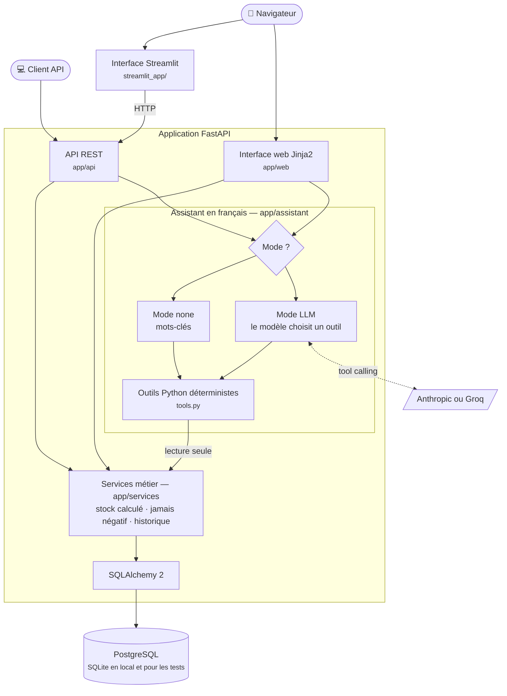
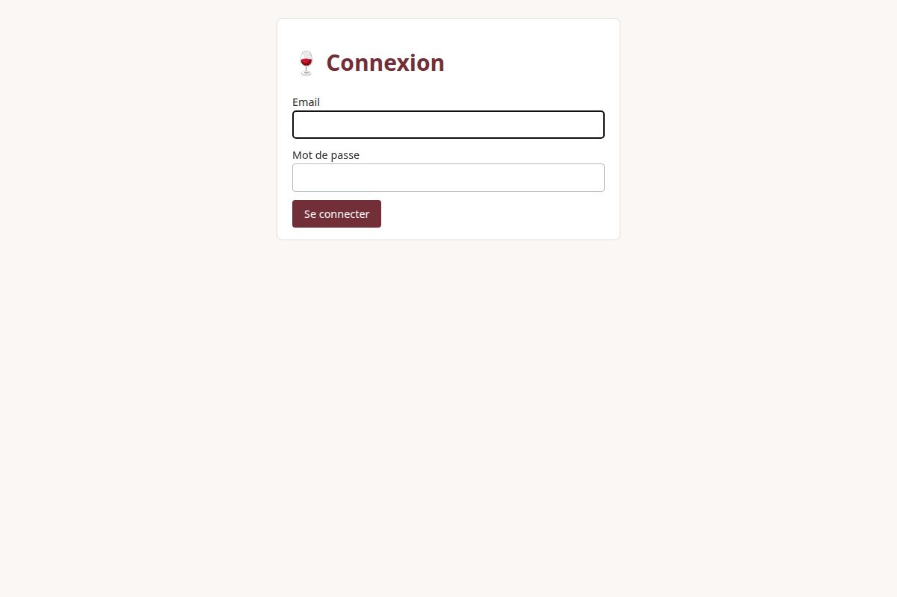
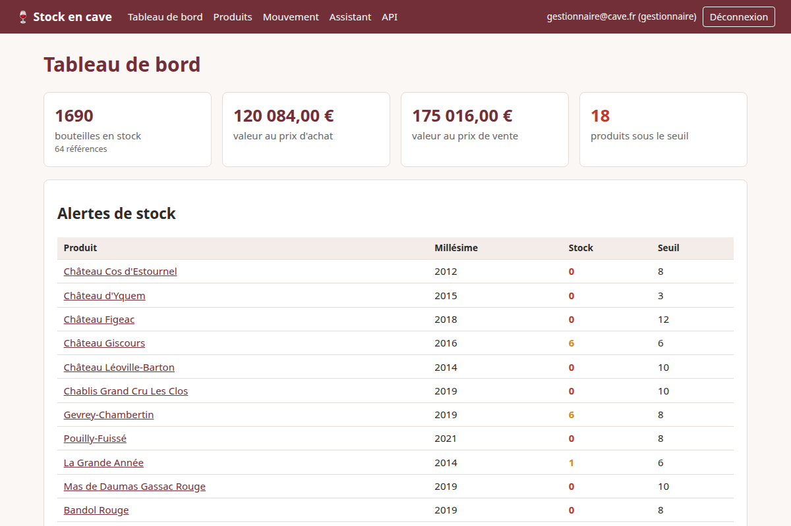
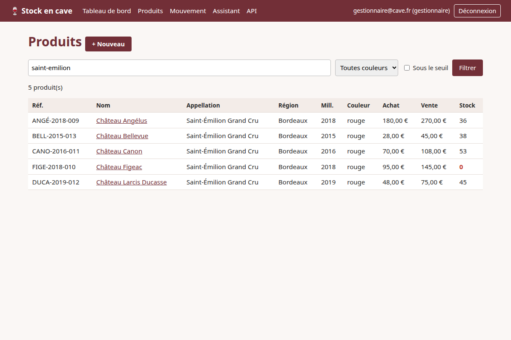
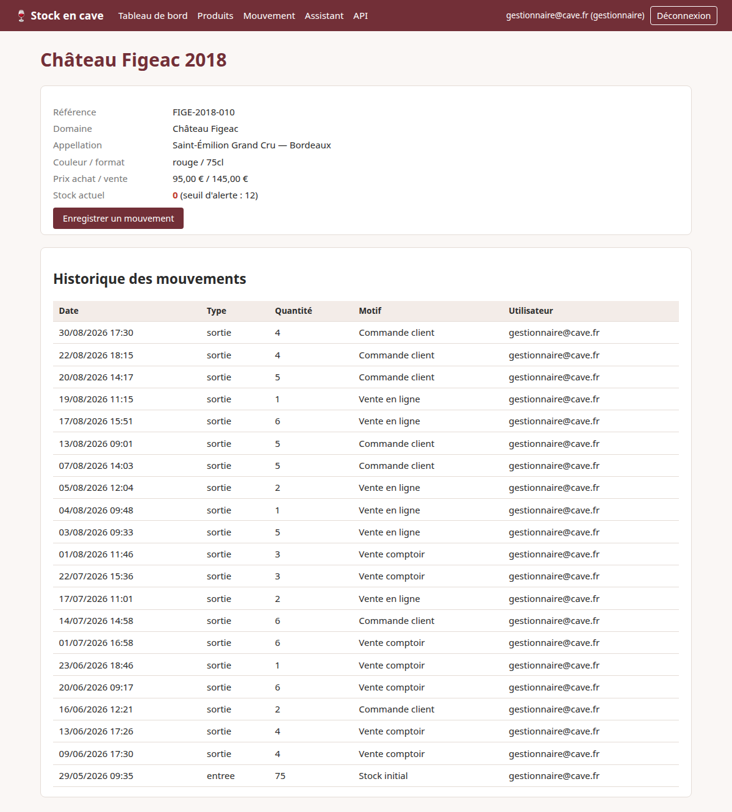
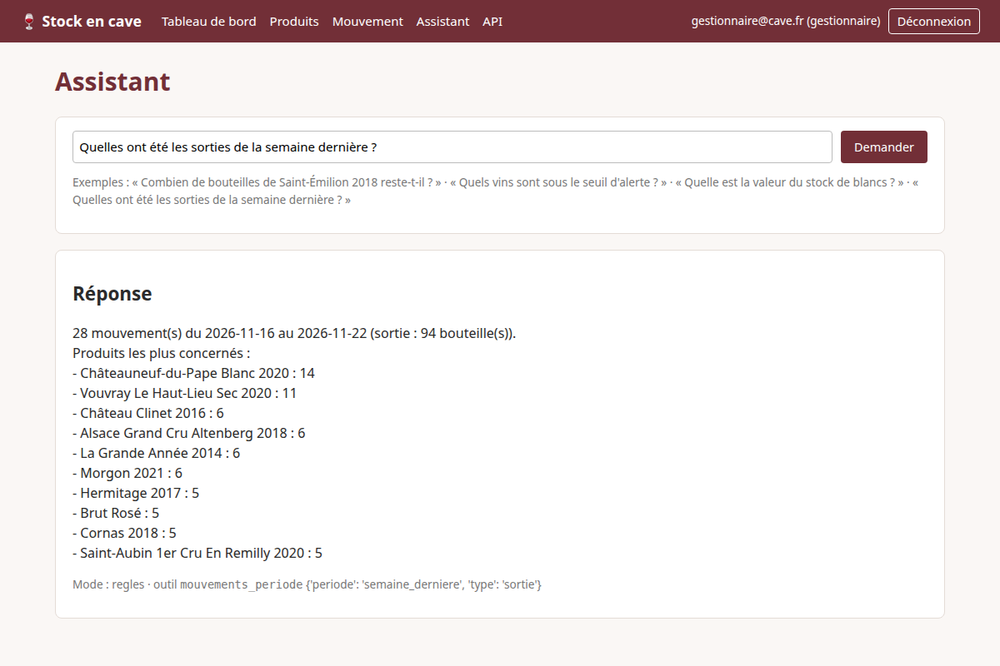

# 🍷 Stock en cave

Application web de suivi de stock pour une cave / un négoce de vins, avec un **assistant en français** qui répond aux questions sur le stock (« Quels vins sont sous le seuil d'alerte ? ») **sans jamais générer de SQL ni inventer un chiffre**.

Projet de portfolio : un outil interne simple, testé (57 tests), documenté, avec une fonctionnalité d'IA utile à des équipes non techniques.

## Objectif

- Suivre les produits (vins) et leurs mouvements (entrées, sorties, ajustements d'inventaire).
- Savoir à tout moment : combien reste-t-il, quelle valeur, quoi réapprovisionner.
- Interroger le stock en langage naturel, avec des réponses fiables (chiffres issus de fonctions Python, pas du modèle).

## Architecture



Les routes web et API utilisent aussi SQLAlchemy directement pour certaines opérations simples (produits, comptes).

```
app/
  models/      tables SQLAlchemy (products, stock_movements, users)
  services/    logique de stock, périodes, recherche sans accents
  api/         routes REST (auth, produits, mouvements, stock, utilisateurs, assistant)
  assistant/   tools.py (outils), rules.py (mode règles), llm.py (Anthropic/Groq), agent.py
  web/         routes + templates Jinja2 + CSS
  seed.py      données de démonstration
streamlit_app/ interface Streamlit (client de l'API)
alembic/       migrations      tests/  pytest      eval/  évaluation de l'assistant
```

## Modèle de données

| Table | Colonnes principales |
|---|---|
| `products` | référence (unique), nom, domaine, appellation, région, millésime (NULL = non millésimé), couleur (rouge/blanc/rose/effervescent), format, prix d'achat, prix de vente, seuil d'alerte, `search_text` (texte normalisé pour la recherche) |
| `stock_movements` | produit, type (`entree` / `sortie` / `ajustement`), quantité, date, motif, utilisateur |
| `users` | email (unique), mot de passe haché (bcrypt), rôle (`admin` / `gestionnaire` / `lecture_seule`), actif |

**Le stock n'est jamais stocké** : stock = Σ (entrées + ajustements − sorties). Une sortie (ou un ajustement négatif) qui rendrait le stock négatif est refusée (HTTP 409), avec verrou de ligne sous PostgreSQL pour éviter deux sorties concurrentes.

## Installation

### Avec Docker (base PostgreSQL + application)

```bash
cp .env.example .env        # optionnel : clés LLM (voir plus bas)
docker compose up --build -d   # ou : make up
docker compose exec app python -m app.seed --reset   # ou : make seed
```

Puis ouvrir <http://localhost:8000> (documentation OpenAPI : <http://localhost:8000/docs>).
Les migrations Alembic sont appliquées automatiquement au démarrage du conteneur.
Pour lancer en local (`make run`), arrêtez d'abord le conteneur (`make down`, port 8000) et, pour SQLite, commentez `DATABASE_URL` dans `.env` (sinon `.env.example` vise le PostgreSQL de compose).

Comptes de démonstration (créés par le seed) :

| Rôle | Email | Mot de passe |
|---|---|---|
| admin | admin@cave.fr | admin1234 |
| gestionnaire | gestionnaire@cave.fr | gestion1234 |
| lecture seule | lecture@cave.fr | lecture1234 |

### En local (SQLite, sans Docker)

```bash
make install        # venv + dépendances
make seed-local     # migrations + données de démo
make run            # http://127.0.0.1:8000
make test           # 57 tests
make eval           # évaluation de l'assistant
make lint           # ruff
```

### Configuration (`.env`)

| Variable | Rôle |
|---|---|
| `DATABASE_URL` | base (défaut : SQLite `./stock.db`) |
| `SECRET_KEY` | signature des jetons JWT (**à changer en production**) |
| `LLM_PROVIDER` | `anthropic`, `groq` ou `none` (mode règles, défaut) |
| `ANTHROPIC_API_KEY` / `GROQ_API_KEY` / `LLM_MODEL` | clé et modèle (défauts : `claude-haiku-5-5`, `openai/gpt-oss-120b`) |

Sans clé valide, l'assistant retombe automatiquement en mode règles (et si le LLM est en panne en cours de route, il le signale et répond en mode règles).

## Interface Streamlit

En plus de l'interface Jinja, une interface **Streamlit** (`streamlit_app/app.py`) permet d'utiliser l'application : connexion, tableau de bord, produits + fiche + historique, formulaire de mouvement, assistant sous forme de chat. C'est un simple **client de l'API REST** (aucune logique métier dupliquée : rôles, règle du stock négatif et outils de l'assistant restent côté API).

```bash
docker compose up --build -d     # lance aussi Streamlit → http://localhost:8501
# ou en local, API déjà lancée sur :8000 :
make streamlit                   # API_URL=http://localhost:8000 par défaut (variable d'environnement)
```

## Usage (captures)

| | |
|---|---|
|  |  |
|  |  |



Exemple d'appel API :

```bash
TOKEN=$(curl -s -d "username=gestionnaire@cave.fr&password=gestion1234" localhost:8000/api/auth/token | jq -r .access_token)
curl -H "Authorization: Bearer $TOKEN" localhost:8000/api/stock/valeur
curl -H "Authorization: Bearer $TOKEN" -H "Content-Type: application/json" \
     -d '{"product_id":1,"type":"sortie","quantite":99999}' localhost:8000/api/movements
# → 409 {"detail":"Stock insuffisant pour « Château Lynch-Bages » : 54 en stock, mouvement de -99999 refusé"}
```

Droits : `lecture_seule` ne peut rien modifier ; `gestionnaire` crée/modifie des produits et enregistre des mouvements ; seul `admin` supprime un produit (sans historique) et gère les utilisateurs (API `/api/users`).

## L'assistant : pourquoi du tool calling plutôt que du SQL libre ?

```
Question ──► LLM ──choisit──► outil(paramètres)  ──► fonction Python (lecture seule) ──► JSON
                  ◄──────────────── résultat ────────────────────────────────────────────┘
          LLM rédige la réponse en citant uniquement ce JSON
```

Cinq outils (`app/assistant/tools.py`) : `stock_produit`, `produits_sous_seuil`, `resume_stock` (bouteilles + valeur achat/vente, filtrable par couleur, région, millésime), `mouvements_periode`, `historique_produit`.

Pourquoi pas du SQL généré par le modèle ?

- **Fiabilité** : « stock » = somme de mouvements signés ; un LLM peut se tromper sur cette règle. Ici elle est écrite et testée **une seule fois** dans le code.
- **Sécurité** : le modèle ne touche jamais à la base. Il ne peut appeler que 5 fonctions en lecture seule, dont les arguments sont validés par Pydantic (un argument invalide renvoie une erreur que le modèle peut corriger).
- **Vérifiabilité** : chaque réponse affiche l'outil et les arguments utilisés ; on peut les rejouer.
- **Même socle pour les deux modes** : le mode règles (`LLM_PROVIDER=none`) appelle exactement les mêmes fonctions, donc l'évaluation compare à armes égales.

Garde-fous : prompt système (« n'invente jamais un chiffre », « hors périmètre / ambigu → ne pas appeler d'outil et le dire »), `{date}` injectée pour résoudre « la semaine dernière » (lundi→dimanche), 4 tours d'outils maximum.

## Évaluation de l'assistant

`eval/questions.yaml` : 15 questions (13 avec outil attendu, 1 hors périmètre, 1 ambiguë). Les réponses attendues sont **calculées depuis les données seed** par `eval/generate_questions.py` avec de simples boucles Python (sans passer par les outils), sur une base temporaire ancrée à une date fixe (2026-11-25) pour être reproductible. `eval/run_eval.py` mesure :

- **bon outil** : le premier outil appelé est celui attendu (ou aucun pour hors périmètre/ambigu) ;
- **réponse correcte** : tous les chiffres/textes attendus figurent dans la réponse.

**Résultats réels** (`make eval`; sorties complètes dans `eval/dernier_resultat.txt` pour le mode règles et `eval/resultat_groq.txt` pour Groq) :

| Mode | Bon outil | Réponses correctes |
|---|---|---|
| Règles (`LLM_PROVIDER=none`) | 15/15 (100 %) | 15/15 (100 %) |
| LLM : Groq `openai/gpt-oss-120b` (15 réponses réellement issues du LLM) | 15/15 (100 %) | 15/15 (100 %) |

Anthropic (`claude-haiku-5-5`) n'a pas été mesuré (pas de clé API disponible).

⚠ **Lecture honnête de ces chiffres :**

- **Le script affiche désormais le mode réellement utilisé par chaque réponse.** Un appel LLM en échec retombe en mode règles ; une première exécution « Groq » à 100 % était en réalité 100 % règles (le modèle par défaut que j'avais choisi, `llama-3.3-70b-versatile`, n'existait plus chez Groq → remplacé).
- **Historique avant d'arriver à 15/15 avec Groq** : limite de débit de l'offre gratuite (8 000 tokens/min → nouvel essai automatique sur erreur 429) ; puis 13/15 : sur 2 questions « liste de produits sous le seuil », le modèle listait les vins sans donner leur nombre ; puis une réponse repliée en règles car le modèle écrivait `"Rouge"` (majuscule) alors que le schéma n'accepte que `rouge` (rejet serveur 400). J'ai corrigé en précisant « minuscules » dans le schéma d'outil et en ajoutant au prompt « indique le nombre total d'éléments d'une liste ».
- **Ces ajustements de prompt ont été faits en regardant les erreurs de ce même jeu de 15 questions** : le 15/15 est donc optimiste (sur-ajustement possible). Une seule exécution (le LLM n'est pas strictement déterministe), 15 questions seulement, offre gratuite sujette aux limites de débit : une évaluation sérieuse demanderait plus de questions, un jeu de test séparé et plusieurs exécutions.
- Le mode règles est lui aussi optimiste : règles écrites sur les mêmes familles de questions. Le premier passage donnait 14/15 (« prix de **vente** » pris pour des ventes) ; corrigé avec un test de non-régression.

## Tests et qualité

- `pytest` (57 tests, SQLite en mémoire) : calcul du stock, refus du stock négatif, droits par rôle (API et web), CRUD et endpoints principaux, **un test par outil** de l'assistant, routage du mode règles, boucle de tool calling Anthropic et Groq (simulés).
- `ruff` (format + lint). Workflow GitHub Actions : `.github/workflows/tests.yml` lance lint, pytest et l'évaluation (mode règles) à chaque push.
- Vérifié en réel pendant le développement : migration Alembic + seed + API + pages web + captures d'écran sur un **vrai PostgreSQL** (binaire embarqué) .

## Limites connues et pistes d'amélioration

- `docker compose up --build` + seed vérifiés sur la machine de l'auteur (PostgreSQL 16, migrations auto, interface accessible sur le port 8000).
- Mode LLM évalué uniquement avec Groq (offre gratuite, limitée en débit) ; Anthropic non mesuré ; modèles non comparés entre eux.
- Un mouvement **antidaté** est vérifié contre le stock *courant*, pas contre le stock à la date du mouvement.
- Pas de protection CSRF dédiée sur les formulaires web (cookie `HttpOnly` + `SameSite=Lax` seulement), pas de limitation de débit sur la connexion, pas de gestion web des utilisateurs (API uniquement).
- Mode règles : vocabulaire limité (français, 5 intentions), une seule intention par question ; l'assistant n'a pas de mémoire de conversation.
- Les mots de passe de démo sont publics : à changer, ainsi que `SECRET_KEY`, avant tout déploiement.
- Couleur « rosé » stockée sous la valeur `rose` (affichée telle quelle).
- Pistes : contrôle automatique que chaque nombre de la réponse du LLM figure dans le résultat de l'outil, historique de conversation, export CSV, inventaire par lot, pagination des listes, notifications d'alerte par email.

## Choix faits sans me poser la question

Seuil d'alerte = stock **≤** seuil · ajustement = quantité signée (écart d'inventaire) · authentification par JWT (en-tête `Bearer` pour l'API, cookie `HttpOnly` pour le web) · énumérations stockées en texte (portable PostgreSQL/SQLite) · recherche sur un champ `search_text` normalisé (sans accents, indépendant de la base, pas d'extension `unaccent`) · semaines du lundi au dimanche · ~64 vins et ~950 mouvements dans le seed (déterministe, graine fixe) · suppression d'un produit refusée s'il a un historique.
